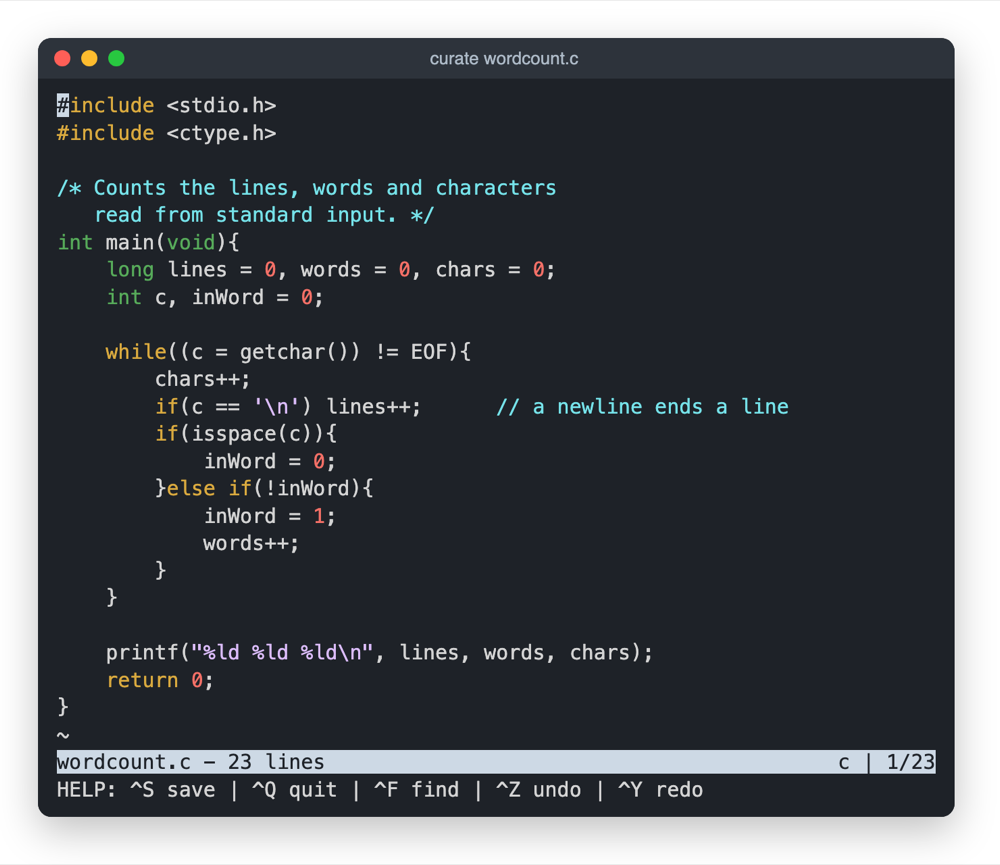

# curate

A small terminal text editor written from scratch in C, with no libraries beyond the standard POSIX
headers. Inspired by my favourite editors, [Kate](https://github.com/KDE/kate) and
[Nano](https://github.com/madnight/nano).



## Features

- **Open, edit and save files.** Opening a file that doesn't exist creates it on the first save, and
  saving an unnamed buffer asks for a filename.
- **Move around** with the arrow keys, Home/End and Page Up/Down. The cursor wraps between lines, and
  the view scrolls vertically and horizontally to follow it.
- **Edit** by typing, Enter to split a line, and Backspace/Delete, which join lines at their edges.
- **Incremental search:** results update as you type, the arrow keys jump between matches, and Esc
  puts the cursor back where you started.
- **Status bar** with the filename, line count, current line and a "(modified)" flag, plus a message
  bar for help, prompts and errors.
- **Syntax highlighting** for C/C++ and Python: keywords, types, strings, numbers, and comments,
  including `/* ... */` comments that span several lines. Search matches are highlighted too.
- **Undo and redo** (Ctrl-Z / Ctrl-Y). Typing a word is one undo step, and up to 200 steps are kept.
- **Resizing:** the screen redraws to fit when you resize the terminal.
- **Tabs** display as 4 spaces but are saved as tabs.
- **Safe quit:** Ctrl-Q warns once if there are unsaved changes.

## Keys

| Key | Action |
| --- | --- |
| Ctrl-S | Save |
| Ctrl-Q | Quit (press twice if there are unsaved changes) |
| Ctrl-F | Search |
| Ctrl-Z / Ctrl-Y | Undo / redo |
| Arrows, Home, End, Page Up, Page Down | Move |

## Build and run

Needs a C compiler and `make` on macOS or Linux. It builds cleanly with
`-Wall -Wextra -Werror -pedantic -std=c99`.

```bash
make
./curate notes.txt
```

## How it works

- **Raw mode:** turns off the terminal's line buffering, echo, Ctrl-C/Ctrl-Z signals and output
  post-processing so every keypress reaches the editor, and restores your settings on exit, even after
  an error.
- **Keys:** multi-byte escape sequences (arrows, Home/End, Page Up/Down, Delete) are decoded into
  single key codes.
- **Text model:** each line is stored twice, as typed (`chars`) and as drawn (`render`, with tabs
  expanded), so the cursor can map between file columns and screen columns.
- **Drawing:** each frame is built in an append buffer and written with a single `write()`, with the
  cursor hidden while drawing, so the screen doesn't flicker.
- **Window size:** read with `ioctl(TIOCGWINSZ)`, falling back to moving the cursor to the corner and
  asking the terminal where it is. A `SIGWINCH` handler flags resizes, and the key-reading loop
  redraws when it sees the flag.
- **Highlighting:** each line keeps one highlight value per character. A line that ends inside a
  `/* comment */` marks itself, and changing that re-colours the following line, so multi-line comments
  stay correct as you edit.
- **Undo:** before each group of edits, the whole buffer and cursor are copied onto an undo stack.
  It's simple and reliable, and fast enough for the files a small editor is for.

## Tests

`tests/pty_test.py` runs the editor in a pseudo-terminal, types real keystrokes and checks the saved
files. It covers editing, saving, save-as, quit warnings, scrolling, search, syntax highlighting, resizing,
and undo and redo (26 checks).

```bash
make
python3 tests/pty_test.py
```

## Next steps

- More languages (JavaScript, Java, Go)
- Line numbers
- Copy, cut and paste
